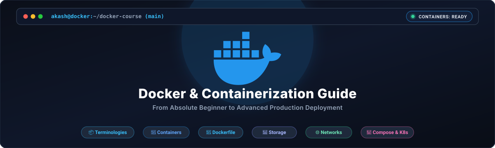

<div align="center">



# 🐳 Docker & Containerization — Master Course & Reference
### *From Absolute Beginner to Advanced Production Deployment*

[](https://www.docker.com)
[](#-course-syllabus)
[](#-course-syllabus)
[](./LICENSE)

---

</div>

Welcome to the **Docker & Containerization Master Course**! This repository is a comprehensive, production-grade learning resource designed to take you from a complete beginner with zero prior experience to an advanced container engineer capable of packaging, scaling, securing, and deploying multi-container microservices.

---

## 🌟 Why This Course?

- 📖 **Terminology-First Approach:** Module 01 breaks down every complex container jargon term (Container, Image, Daemon, Volume, Network, Layer, Compose, Namespaces, Cgroups, etc.) into simple, plain English with everyday analogies.
- 🎨 **Visual Diagrams:** Built-in GitHub-native Mermaid diagrams illustrating architecture, layer caching, storage mounts, and network topologies.
- ⚡ **Production-Ready Best Practices:** Learn multi-stage builds, non-root container security, layer caching optimization, and healthchecks.
- 🚀 **Hands-On & Practical:** Every module contains real-world terminal commands, working principles, parameter breakdowns, and practical exercises.

---

## 📚 Course Syllabus

| Module | Title | Primary Topics & Key Skills Covered | Link |
| :---: | :--- | :--- | :---: |
| **01** | **The Complete Docker Dictionary** | Container vs VM, Images, Containers, Daemon, Dockerfile, Docker Hub, Volumes, Networks, Compose, Namespaces, Cgroups | [📖 Start Module](./modules/01-terminologies.md) |
| **02** | **Docker Architecture & Setup** | Client-Server Model, REST API, Engine vs Desktop, Linux/macOS/Windows Installation, post-installation without sudo | [📖 Start Module](./modules/02-architecture-setup.md) |
| **03** | **Container Operations & CLI** | `run`, `-it` vs `-d`, lifecycle (`stop`/`start`/`rm`), port mapping `-p`, `logs`, `exec`, `inspect`, `stats` | [📖 Start Module](./modules/03-container-basics.md) |
| **04** | **Docker Images & Registries** | Tagging conventions, UnionFS & copy-on-write layering, `pull`, `push`, `tag`, `rmi`, Docker Hub, `save`/`load` | [📖 Start Module](./modules/04-working-with-images.md) |
| **05** | **Dockerfile Mastery** | `FROM`, `WORKDIR`, `COPY` vs `ADD`, `RUN`, `CMD` vs `ENTRYPOINT`, `ARG` vs `ENV`, `.dockerignore`, image building | [📖 Start Module](./modules/05-dockerfile-mastery.md) |
| **06** | **Data Persistence & Storage** | Ephemeral storage problem, Named Volumes, Bind Mounts, `tmpfs`, PostgreSQL database persistence lab, backups | [📖 Start Module](./modules/06-volumes-storage.md) |
| **07** | **Docker Networking** | `bridge`, `host`, `none`, `macvlan`, `overlay`, custom bridges, DNS service resolution, inter-container ping lab | [📖 Start Module](./modules/07-docker-networking.md) |
| **08** | **Docker Compose Mastery** | Multi-container apps, `compose.yaml` specification, services, volumes, networks, `.env` files, `up`/`down`/`ps`/`logs` | [📖 Start Module](./modules/08-docker-compose.md) |
| **09** | **Optimization & Security** | Multi-Stage builds (1GB -> 15MB), Alpine/Distroless/Scratch, non-root `USER`, healthchecks, Trivy scanning, resource caps | [📖 Start Module](./modules/09-optimization-security.md) |
| **10** | **Orchestration & Capstone** | Swarm vs K8s overview, GitHub Actions CI/CD automation, 5-tier Microservices Capstone Project (Nginx+React+FastAPI+Redis+Postgres) | [📖 Start Module](./modules/10-orchestration-capstone.md) |

---

## ⚡ Fast-Track Command Quick Reference

```bash
# === CONTAINER OPERATIONS ===
docker run -d -p 8080:80 --name my-web nginx:alpine   # Run detached with port mapping
docker ps                                             # List running containers
docker ps -a                                          # List all containers (including stopped)
docker logs -f my-web                                 # Stream container logs live
docker exec -it my-web sh                             # Open interactive shell inside container
docker stop my-web && docker rm my-web                # Stop and delete container

# === IMAGE OPERATIONS ===
docker build -t username/my-app:v1.0 .                # Build image from Dockerfile
docker images                                         # List local images
docker pull python:3.11-slim                          # Download image from Docker Hub
docker push username/my-app:v1.0                      # Upload image to Docker Hub
docker image prune -a -f                              # Remove unused images (free space)

# === VOLUMES & NETWORKS ===
docker volume create my_data                          # Create persistent volume
docker network create my_net                          # Create custom bridge network
docker run -d --network my_net -v my_data:/data redis # Attach volume and network

# === DOCKER COMPOSE ===
docker compose up -d                                  # Start multi-container stack in background
docker compose ps                                     # View compose services status
docker compose logs -f                                # View live logs from all services
docker compose down -v                                # Stop stack and delete volumes
```

---

## 🚀 How to Use This Repository

1. **Clone the Repository:**
   ```bash
   git clone https://github.com/akashs278/docker.git
   cd docker
   ```
2. **Follow the Sequential Path:**
   - Start with **[Module 01: Terminologies](./modules/01-terminologies.md)** to establish your vocabulary foundation.
   - Proceed sequentially through Modules 02 to 10.
3. **Practice Commands:** Open your terminal and run the provided command examples to build muscle memory.

---

## 📄 License

This repository is licensed under the [MIT License](./LICENSE) - feel free to use, modify, and share!
