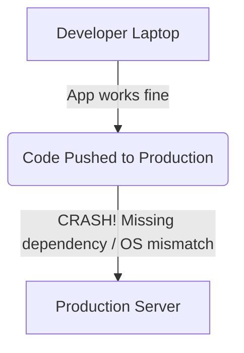
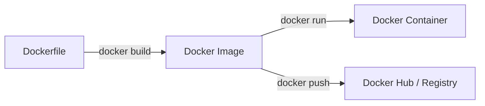

# Module 01 — The Complete Docker & Container Dictionary

> **🏠 [← Back to Main Course](../README.md)** | **Next: [Module 02 — Architecture & Setup →](./02-architecture-setup.md)**

---

## 📋 Table of Contents
- [1.1 Why Containerization Exists (The Problem solved)](#11-why-containerization-exists-the-problem-solved)
- [1.2 Core Docker Concepts & Everyday Analogies](#12-core-docker-concepts--everyday-analogies)
- [1.3 Engine & System Terminologies](#13-engine--system-terminologies)
- [1.4 Storage & Data Terminologies](#14-storage--data-terminologies)
- [1.5 Networking & Communication Terminologies](#15-networking--communication-terminologies)
- [1.6 Ecosystem & Orchestration Terminologies](#16-ecosystem--orchestration-terminologies)
- [1.7 Summary Cheatsheet of Terminologies](#17-summary-cheatsheet-of-terminologies)

---

## 1.1 Why Containerization Exists (The Problem solved)

Before Docker, software developers faced a classic nightmare known as **"It works on my machine!"**

- On the developer's laptop, Node.js version 20, Python 3.11, and PostgreSQL 15 were installed.
- On the production Linux server, Node.js version 16 was installed, causing the app to crash instantly.

### The Shipping Container Analogy
Before 1956, loading cargo onto ships was chaotic. Barrels, boxes, sacks, and cars were loaded individually, taking days. Then the standardized **intermodal shipping container** was invented.

No matter what is inside the shipping container (electronics, furniture, fruit, clothing), every crane, truck, train, and ship in the world can handle the exact same steel container box.

**Docker does the exact same thing for software!** You put your code, dependencies, settings, and runtime into a "Docker Container". Any computer running Docker can run your app instantly without installing anything else.

---

## 1.2 Core Docker Concepts & Everyday Analogies

Here is every fundamental term explained in simple words:

### 1. Docker Image
* **Simple Definition:** A read-only blueprint, template, or snapshot containing your code, libraries, and runtime environment.
* **Real-World Analogy:** A **cooking recipe** or an **ISO file** / **game installation CD**.
* **Key Characteristic:** Images are immutable (they cannot be changed once built).

### 2. Docker Container
* **Simple Definition:** A running, isolated instance created from a Docker Image.
* **Real-World Analogy:** The **actual dish** cooked from the recipe, or the **running game** launched from the CD.
* **Key Characteristic:** Containers are lightweight, isolated processes. You can create 10 containers from 1 single image.

### 3. Dockerfile
* **Simple Definition:** A plain text file containing a step-by-step list of instructions used by Docker to build a Docker Image.
* **Real-World Analogy:** The **written instruction manual** or **blueprint draft**.

### 4. Container Registry (e.g., Docker Hub)
* **Simple Definition:** An online cloud storage library where Docker Images are uploaded, shared, and downloaded.
* **Real-World Analogy:** **GitHub for Docker Images** or the **Google Play Store / Apple App Store**.
* **Popular Registries:** Docker Hub (`hub.docker.com`), GitHub Container Registry (`ghcr.io`), Amazon ECR, Google Artifact Registry.

---

## 1.3 Engine & System Terminologies

### 1. Docker Daemon (`dockerd`)
* **Simple Definition:** The background service (the "brain") running on your host OS that builds, runs, monitors, and manages containers.
* **Working Principle:** It listens for requests from the Docker CLI and does the heavy lifting.

### 2. Docker Client (`docker CLI`)
* **Simple Definition:** The command-line tool you interact with in your terminal (e.g. typing `docker run ...`). It sends commands to the Docker Daemon.

### 3. Host System (Host Machine)
* **Simple Definition:** The actual physical computer or virtual machine (laptop, server) where Docker is installed and running.

### 4. Namespaces
* **Simple Definition:** A Linux kernel feature that gives containers their own isolated view of the system (their own process tree, network interfaces, user accounts, and mount points).
* **Why it matters:** Container A cannot see or tamper with processes in Container B.

### 5. Control Groups (cgroups)
* **Simple Definition:** A Linux kernel feature that limits and measures how much CPU, memory, disk I/O, and network bandwidth a container is allowed to use.
* **Why it matters:** Prevents a single runaway container from crashing your entire server.

### 6. OCI (Open Container Initiative)
* **Simple Definition:** The open industry standard specification for container formats and runtimes (ensuring images built with Docker work with Podman, Kubernetes, etc.).

---

## 1.4 Storage & Data Terminologies

### 1. Ephemeral Storage (Layered File System)
* **Simple Definition:** By default, any data written inside a container is deleted when the container is removed.
* **Why:** Containers are designed to be disposable and stateless.

### 2. Docker Volume
* **Simple Definition:** A dedicated storage folder created and managed by Docker on the host machine to store persistent data outside the container.
* **Real-World Analogy:** An **external hard drive** plugged into your container. If the container dies, the hard drive keeps your database files safe.

### 3. Bind Mount
* **Simple Definition:** Linking a specific existing folder on your host machine (like `/home/user/project`) directly into a folder inside the container.
* **Use Case:** Perfect for local development so code changes reflect instantly inside the container without rebuilding the image.

---

## 1.5 Networking & Communication Terminologies

### 1. Bridge Network
* **Simple Definition:** The default private virtual network created by Docker on your host machine. Containers on the same bridge network can talk to each other using internal IP addresses or container names.

### 2. Port Mapping / Port Forwarding (`-p host:container`)
* **Simple Definition:** Opening a doorway so traffic from outside your computer can reach an app inside a container.
* **Example:** `-p 8080:80` redirects traffic arriving at `localhost:8080` on your laptop to port `80` inside the container.

### 3. Host Network Mode
* **Simple Definition:** Attaching a container directly to the host machine's network interface without network isolation (faster, but shares port numbers with host).

---

## 1.6 Ecosystem & Orchestration Terminologies

### 1. Docker Compose
* **Simple Definition:** A tool for defining and running multi-container Docker applications using a single YAML configuration file (`compose.yaml`).
* **Real-World Analogy:** The **orchestra conductor** that starts your Web App, Database, Redis Cache, and Nginx proxy with a single command (`docker compose up`).

### 2. Multi-Stage Build
* **Simple Definition:** A technique in a Dockerfile where you use multiple `FROM` lines to separate the build environment (compiling code) from the runtime environment (running code), resulting in tiny, secure production images.

### 3. Container Orchestration (Kubernetes / Docker Swarm)
* **Simple Definition:** Automated management tools that handle scaling, load balancing, self-healing (restarting failed containers), and rolling updates across a cluster of multiple server nodes.

---

## 1.7 Summary Cheatsheet of Terminologies

| Term | Category | Everyday Analogy | What it Does |
| :--- | :--- | :--- | :--- |
| **Dockerfile** | Build | Instruction Manual | Blueprint steps to build an image |
| **Docker Image** | Storage | Recipe / Installer CD | Read-only package of app + dependencies |
| **Container** | Runtime | Cooked Meal / Running Game | Live, isolated running process |
| **Docker Hub** | Cloud | App Store / GitHub | Remote repository for downloading images |
| **Docker Daemon** | Engine | System Brain | Background service managing containers |
| **Volume** | Storage | External Hard Drive | Persistent storage that survives container deletion |
| **Port Mapping** | Network | House Door Number | Directs host port traffic into container port |
| **Docker Compose** | Multi-App | Conductor | Manages multi-container stacks via YAML |

---

> **👉 Next Step:** Learn how the Docker Client-Daemon architecture functions and how to install Docker properly in **[Module 02 — Architecture & Setup](./02-architecture-setup.md)**.
