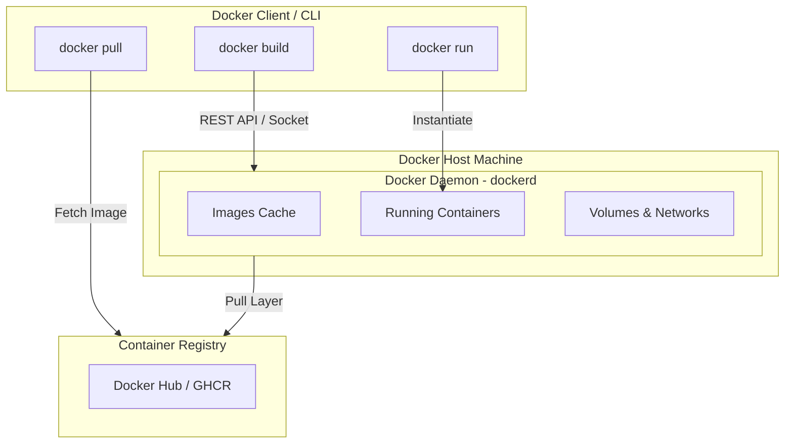
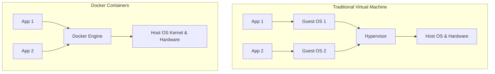

# Module 02 — Docker Architecture & Installation Guide

> **🏠 [← Back to Main Course](../README.md)** | **[← Module 01](./01-terminologies.md)** | **Next: [Module 03 — Container Basics →](./03-container-basics.md)**

---

## 📋 Table of Contents
- [2.1 Docker Client-Server Architecture](#21-docker-client-server-architecture)
- [2.2 Under the Hood: How Linux Powers Docker](#22-under-the-hood-how-linux-powers-docker)
- [2.3 Docker Engine vs Docker Desktop](#23-docker-engine-vs-docker-desktop)
- [2.4 Installation Guide](#24-installation-guide)
  - [Ubuntu / Linux Installation](#ubuntu--linux-installation)
  - [Post-Installation (Run Docker Without sudo)](#post-installation-run-docker-without-sudo)
  - [macOS & Windows Setup](#macos--windows-setup)
- [2.5 Verifying Your Docker Installation](#25-verifying-your-docker-installation)

---

## 2.1 Docker Client-Server Architecture

Docker uses a **Client-Server architecture**. The Docker client communicates with the Docker daemon, which does the heavy lifting of building, running, and distributing your Docker containers.



### 1. The Client (`docker`)
When you type a command like `docker run nginx` in your terminal, the `docker` command-line utility converts your command into a REST API request and sends it to the Docker Daemon via a Unix domain socket (`/var/run/docker.sock`) or TCP network interface.

### 2. The Daemon (`dockerd`)
The Docker daemon runs continuously in the background on the host system. It listens for Docker API requests and manages Docker objects, such as images, containers, networks, and volumes.

### 3. The Registry
A registry stores Docker images. Docker Hub is a public registry that anyone can use, and Docker is configured to look for images on Docker Hub by default.

---

## 2.2 Under the Hood: How Linux Powers Docker

Docker is not a Virtual Machine (VM). Virtual Machines require a full copy of an operating system, a virtual hypervisor, and gigabytes of RAM. Docker containers share the host Linux kernel directly, making them start in milliseconds and use megabytes of memory instead of gigabytes.



### Three Pillar Linux Kernel Technologies Used by Docker:

1. **Namespaces (Isolation):**
   - `pid`: Process isolation (containers only see their own processes).
   - `net`: Network isolation (containers get their own IP address and routing table).
   - `mnt`: Mount point isolation (containers have their own isolated root filesystem).
   - `ipc`: Inter-process communication isolation.
   - `uts`: Hostname isolation.

2. **Control Groups - cgroups (Resource Limits):**
   - Restricts CPU usage (e.g., limit container to 2 CPU cores).
   - Restricts Memory usage (e.g., limit container to 512MB RAM).

3. **Union File Systems - UnionFS (Layering):**
   - Allows files and directories from separate file systems to be transparently overlaid, forming a single coherent file system. Docker uses storage drivers like `overlay2`.

---

## 2.3 Docker Engine vs Docker Desktop

| Feature | Docker Engine (CE) | Docker Desktop |
| :--- | :--- | :--- |
| **Best For** | Linux Servers, CI/CD pipelines, Devs on Linux | macOS & Windows developers |
| **Components** | Daemon, CLI, containerd, runc | GUI dashboard + Docker Engine + Kubernetes + VM layer |
| **Resource Cost** | Ultra-lightweight (native Linux performance) | Requires virtual machine layer (WSL2 / HyperKit) |
| **License** | 100% Free & Open Source (Apache 2.0) | Free for personal/small business, paid for enterprise |

---

## 2.4 Installation Guide

### Ubuntu / Linux Installation

The recommended production method is installing via the official Docker repository:

```bash
# 1. Update package index and install prerequisites
sudo apt-get update
sudo apt-get install -y ca-certificates curl gnupg

# 2. Add Docker's official GPG key
sudo install -m 0755 -d /etc/apt/keyrings
curl -fsSL https://download.docker.com/linux/ubuntu/gpg | sudo gpg --dearmor -o /etc/apt/keyrings/docker.gpg
sudo chmod a+r /etc/apt/keyrings/docker.gpg

# 3. Add repository to Apt sources
echo \
  "deb [arch=$(dpkg --print-architecture) signed-by=/etc/apt/keyrings/docker.gpg] https://download.docker.com/linux/ubuntu \
  $(. /etc/os-release && echo "$VERSION_CODENAME") stable" | \
  sudo tee /etc/apt/sources.list.d/docker.list > /dev/null

# 4. Install Docker Engine, CLI, and Docker Compose plugin
sudo apt-get update
sudo apt-get install -y docker-ce docker-ce-cli containerd.io docker-buildx-plugin docker-compose-plugin
```

---

### Post-Installation (Run Docker Without sudo)

By default, the Docker daemon binds to a Unix socket owned by `root`. To run `docker` commands as a normal user without typing `sudo` every time:

```bash
# 1. Create docker group (if it doesn't exist)
sudo groupadd docker

# 2. Add your current user to the docker group
sudo usermod -aG docker $USER

# 3. Activate the changes to groups in current shell session
newgrp docker
```

---

### macOS & Windows Setup

* **macOS:**
  - Download **Docker Desktop for Mac** (Apple Silicon M1/M2/M3 or Intel chip) from [docker.com](https://www.docker.com/products/docker-desktop).
  - Alternative lightweight open-source CLI option: **OrbStack** (`brew install orbstack`).

* **Windows:**
  - Enable **WSL2** (Windows Subsystem for Linux 2) by opening PowerShell as Administrator and running: `wsl --install`.
  - Download and install **Docker Desktop for Windows**. In Settings, ensure **Use the WSL 2 based engine** is checked.

---

## 2.5 Verifying Your Docker Installation

Run these three commands in your terminal to verify Docker is working correctly:

```bash
# Check installed client and server versions
docker version

# View detailed system info (driver, CPU cores, running containers)
docker info

# Run the official test container
docker run hello-world
```

### Expected Output for `docker run hello-world`:
```text
Hello from Docker!
This message shows that your installation appears to be working correctly.

To generate this message, Docker took the following steps:
 1. The Docker client contacted the Docker daemon.
 2. The Docker daemon pulled the "hello-world" image from the Docker Hub.
 3. The Docker daemon created a new container from that image...
```

---

> **👉 Next Step:** Master container execution, lifecycle control, logs, and port mapping in **[Module 03 — Essential Container Operations](./03-container-basics.md)**.
