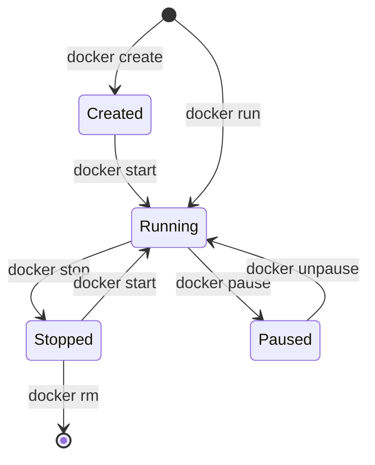

# Module 03 — Essential Container Operations & CLI Mastery

> **🏠 [← Back to Main Course](../README.md)** | **[← Module 02](./02-architecture-setup.md)** | **Next: [Module 04 — Working with Images →](./04-working-with-images.md)**

---

## 📋 Table of Contents
- [3.1 Anatomy of `docker run`](#31-anatomy-of-docker-run)
- [3.2 Interactive vs Detached Modes](#32-interactive-vs-detached-modes)
- [3.3 Container Lifecycle Management](#33-container-lifecycle-management)
- [3.4 Port Mapping Mechanics](#34-port-mapping-mechanics)
- [3.5 Debugging, Inspection & Logs](#35-debugging-inspection--logs)
- [3.6 Resource Monitoring Commands](#36-resource-monitoring-commands)
- [3.7 Operations Command Summary](#37-operations-command-summary)

---

## 3.1 Anatomy of `docker run`

The `docker run` command is the workhorse of Docker. It creates and starts a container from a specified image.

```bash
docker run -d -p 8080:80 --name my-web-server --restart always nginx:alpine
```

### Breaking Down Every Flag:

| Flag / Argument | What It Does | Everyday Explanation |
| :--- | :--- | :--- |
| `docker run` | Primary command | "Create and start a new container" |
| `-d` | Detached mode | Run in the background (release terminal prompt) |
| `-p 8080:80` | Port Mapping | Map host port `8080` to container internal port `80` |
| `--name my-web-server` | Container Name | Assigns a custom friendly name instead of a random generated string |
| `--restart always` | Restart Policy | Automatically reboot container if it crashes or host reboots |
| `nginx:alpine` | Image Name : Tag | The image to instantiate (using lightweight Alpine Linux base) |

---

## 3.2 Interactive vs Detached Modes

### 1. Interactive Shell Mode (`-it`)
Use `-it` (Interactive + TTY) when you want to open a shell terminal inside a container (like an Ubuntu or Alpine sandbox):

```bash
# Launch interactive Ubuntu shell container
docker run -it ubuntu:22.04 bash

# Inside the container prompt:
root@a1b2c3d4e5f6:/# ls -la
root@a1b2c3d4e5f6:/# apt update && apt install -y curl
root@a1b2c3d4e5f6:/# exit
```
> 💡 **Tip:** Type `exit` to stop and leave the container, or press `Ctrl + P`, then `Ctrl + Q` to detach without stopping it!

### 2. Detached Background Mode (`-d`)
Use `-d` for background servers (web servers, databases, queue workers):

```bash
docker run -d --name redis-cache redis:alpine
```

---

## 3.3 Container Lifecycle Management



### Essential Lifecycle Commands:

```bash
# 1. List only RUNNING containers
docker ps

# 2. List ALL containers (including stopped/exited)
docker ps -a

# 3. Stop a running container gracefully (SIGTERM -> 10s -> SIGKILL)
docker stop my-web-server

# 4. Start a stopped container
docker start my-web-server

# 5. Restart a container
docker restart my-web-server

# 6. Force-kill a container immediately (SIGKILL)
docker kill my-web-server

# 7. Remove a stopped container
docker rm my-web-server

# 8. Force remove a running container immediately
docker rm -f my-web-server

# 9. Clean up ALL stopped containers at once (Free disk space)
docker container prune -f
```

---

## 3.4 Port Mapping Mechanics

Containers live inside their own isolated private virtual network. By default, services running inside a container cannot be reached from your host computer or browser.

```text
[ Your Laptop Browser ]  --->  localhost:8080  (Host Port)
                                      |
                             [ Docker Port Forwarder ]
                                      |
[ Nginx Container ]      <---  internal-ip:80  (Container Port)
```

```bash
# Publish container port 80 to host port 8080
docker run -d -p 8080:80 --name test-nginx nginx

# Test in terminal:
curl http://localhost:8080
```

---

## 3.5 Debugging, Inspection & Logs

### 1. Viewing Container Logs (`docker logs`)
```bash
# View all historical logs
docker logs my-web-server

# Stream live logs in real-time (like tail -f)
docker logs -f my-web-server

# View last 50 lines with timestamps
docker logs --tail 50 -t my-web-server
```

### 2. Executing Commands Inside a Running Container (`docker exec`)
Never restart a container just to run a command inside it! Use `docker exec`:

```bash
# Open an interactive bash shell inside a running container
docker exec -it my-web-server sh

# Run a single quick command inside the container without entering
docker exec my-web-server nginx -v
```

### 3. Inspecting Container Metadata (`docker inspect`)
Inspect complete raw JSON details (IP address, volume mounts, environment variables, state):

```bash
# Output full JSON config
docker inspect my-web-server

# Extract just the container's internal IP address
docker inspect -f '{{range .NetworkSettings.Networks}}{{.IPAddress}}{{end}}' my-web-server
```

---

## 3.6 Resource Monitoring Commands

```bash
# Stream live CPU, Memory, Network I/O, and Disk usage for all running containers
docker stats

# Display the running processes inside a container
docker top my-web-server
```

---

## 3.7 Operations Command Summary

```bash
# Quick reference workflow:
docker run -d -p 3000:3000 --name node-app node:18-alpine
docker ps
docker logs -f node-app
docker exec -it node-app sh
docker stop node-app
docker rm node-app
```

---

> **👉 Next Step:** Learn how images work, how layers are cached, and how to push to Docker Hub in **[Module 04 — Working with Images](./04-working-with-images.md)**.
