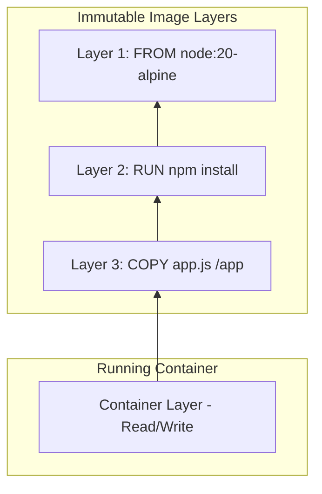
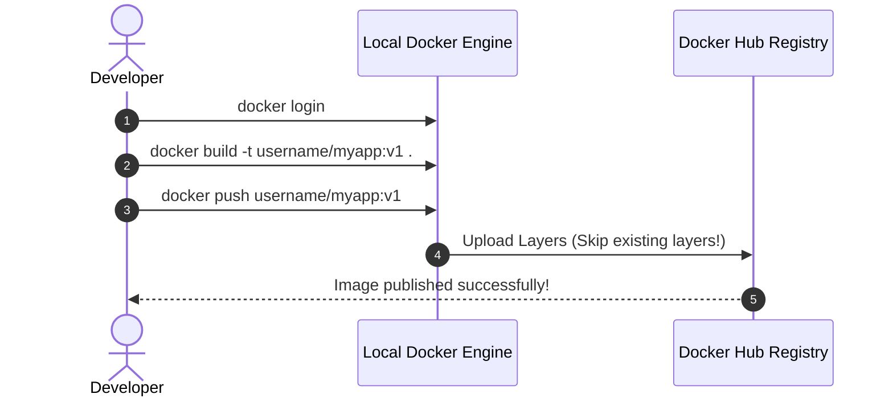

# Module 04 — Docker Images, Layers & Registries

> **🏠 [← Back to Main Course](../README.md)** | **[← Module 03](./03-container-basics.md)** | **Next: [Module 05 — Dockerfile Mastery →](./05-dockerfile-mastery.md)**

---

## 📋 Table of Contents
- [4.1 Image Naming & Tagging Convention](#41-image-naming--tagging-convention)
- [4.2 Image Architecture: Layers & Copy-On-Write](#42-image-architecture-layers--copy-on-write)
- [4.3 Image Management Commands](#43-image-management-commands)
- [4.4 Working with Registries & Docker Hub](#44-working-with-registries--docker-hub)
- [4.5 Exporting & Importing Offline Images](#45-exporting--importing-offline-images)
- [4.6 Image Best Practices](#46-image-best-practices)

---

## 4.1 Image Naming & Tagging Convention

A fully qualified Docker image name follows this structure:

```text
[ registry_hostname / ] [ repository_owner / ] image_name : tag
```

```text
docker.io / akashs278 / my-custom-app : v1.0.0
   │           │             │            │
   │           │             │            └── Tag (Version label)
   │           │             └────────────── Image Name
   │           └──────────────────────────── Owner / Namespace
   └──────────────────────────────────────── Registry Host (Defaults to Docker Hub)
```

### Common Tagging Conventions:
- `latest`: The default tag applied if no tag is specified (e.g. `python` = `python:latest`). **Caution:** `latest` is not guaranteed to be stable!
- Versioned tags: `node:20-alpine`, `postgres:15.3-bullseye`. Always pin explicit versions in production!

---

## 4.2 Image Architecture: Layers & Copy-On-Write

Docker images are composed of multiple **read-only layers**. Each layer represents an instruction in the image's Dockerfile.



### Key Principles of Image Layers:
1. **Layer Caching & Sharing:** If 10 images are built from `ubuntu:22.04`, the `ubuntu` base layer is downloaded only **once** and shared across all 10 images on your hard drive!
2. **Copy-On-Write (CoW):** When a container modifies a file inherited from an image layer, Docker copies the file up to the top Read/Write Container Layer before editing it. The underlying image layer remains untouched.
3. **Immutability:** Once an image layer is built, it can never be changed.

---

## 4.3 Image Management Commands

```bash
# 1. Pull an image from Docker Hub without running it
docker pull python:3.11-slim

# 2. List all locally stored images
docker images

# 3. View the layer history of an image
docker history python:3.11-slim

# 4. Tag an existing image for your repository
docker tag python:3.11-slim myusername/my-python-app:1.0

# 5. Remove a specific image from local storage
docker rmi myusername/my-python-app:1.0

# 6. Remove ALL unused/dangling images (Free disk space)
docker image prune -a -f
```

---

## 4.4 Working with Registries & Docker Hub

### Step-by-Step Workflow: Publishing an Image to Docker Hub



```bash
# Step 1: Authenticate with Docker Hub
docker login

# Step 2: Build and Tag your local image
docker build -t akashs278/demo-api:v1.0 .

# Step 3: Push image layers to Docker Hub
docker push akashs278/demo-api:v1.0

# Step 4: Anyone can now pull and run your app!
docker run -d -p 5000:5000 akashs278/demo-api:v1.0
```

---

## 4.5 Exporting & Importing Offline Images

If you need to transfer a Docker image to an offline server without internet access:

```bash
# 1. Save image to a compressed tar archive file
docker save -o my-app-v1.tar akashs278/demo-api:v1.0

# Transfer my-app-v1.tar via USB or SCP to offline machine...

# 2. Load the image tar archive on the offline machine
docker load -i my-app-v1.tar
```

---

## 4.6 Image Best Practices

1. **Use Minimal Base Images:** Prefer `-alpine` or `-slim` variants (e.g. `node:20-alpine` is ~40MB vs `node:20` full at ~1GB).
2. **Order Directives by Frequency of Change:** Put infrequently changed layers (installing OS dependencies) near the top of your Dockerfile so layer caching speeds up builds.
3. **Pin Explicit Version Tags:** Avoid using `latest` in production Dockerfiles.

---

> **👉 Next Step:** Master writing efficient Dockerfiles from scratch in **[Module 05 — Dockerfile Mastery](./05-dockerfile-mastery.md)**.
