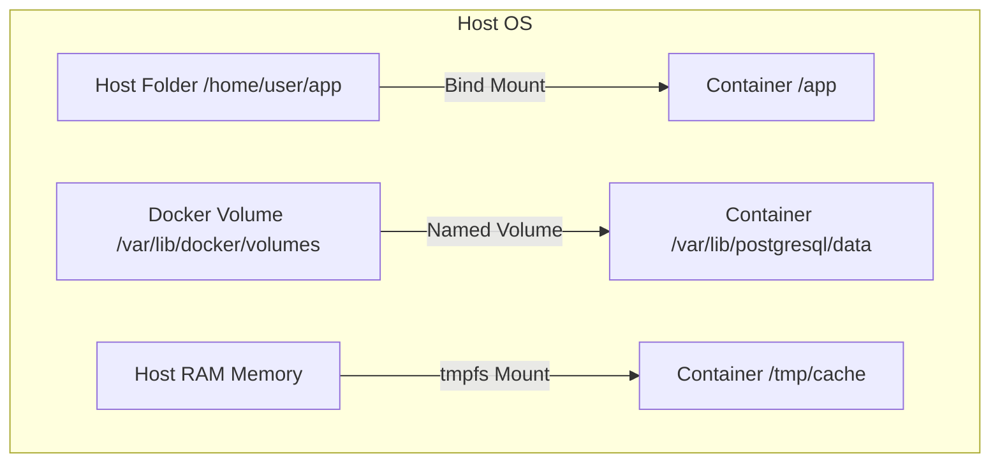

# Module 06 — Data Persistence: Volumes, Bind Mounts & tmpfs

> **🏠 [← Back to Main Course](../README.md)** | **[← Module 05](./05-dockerfile-mastery.md)** | **Next: [Module 07 — Docker Networking →](./07-docker-networking.md)**

---

## 📋 Table of Contents
- [6.1 The Ephemeral Data Problem](#61-the-ephemeral-data-problem)
- [6.2 Comparison of Storage Mount Types](#62-comparison-of-storage-mount-types)
- [6.3 Docker Volumes (Managed Storage)](#63-docker-volumes-managed-storage)
- [6.4 Bind Mounts (Host File System Mapping)](#64-bind-mounts-host-file-system-mapping)
- [6.5 tmpfs Mounts (In-Memory Storage)](#65-tmpfs-mounts-in-memory-storage)
- [6.6 Practical Hands-on: Persisting PostgreSQL Database](#66-practical-hands-on-persisting-postgresql-database)
- [6.7 Volume Backup & Recovery Strategy](#67-volume-backup--recovery-strategy)

---

## 6.1 The Ephemeral Data Problem

By default, all files created inside a container are stored on a writable container layer.
* When the container is deleted (`docker rm`), **all data inside it is lost forever!**
* Updating a container to a new image version requires deleting the old container.

To preserve persistent data (databases, uploaded user images, application logs), Docker provides storage mechanisms outside the container lifecycle.



---

## 6.2 Comparison of Storage Mount Types

| Storage Type | Managed By | Stored On Host At | Primary Use Case |
| :--- | :--- | :--- | :--- |
| **Named Volume** | Docker Engine | `/var/lib/docker/volumes/` | Production databases, persistent application state |
| **Bind Mount** | You (User) | Any explicit path (e.g. `~/project/src`) | Local dev (Hot-reloading code without image rebuild) |
| **tmpfs Mount** | Host System Kernel | Host RAM (Never written to disk) | Storing sensitive secrets, passwords, or temporary cache |

---

## 6.3 Docker Volumes (Managed Storage)

Docker Volumes are completely managed by Docker and isolated from host machine file system clutter.

### Volume CLI Commands:

```bash
# 1. Create a named volume
docker volume create db_data

# 2. List all volumes on the system
docker volume ls

# 3. Inspect volume location and metadata
docker volume inspect db_data

# 4. Attach named volume to a container (-v volume_name:container_path)
docker run -d -v db_data:/var/lib/mysql --name mysql-db mysql:8.0

# 5. Remove an unused volume
docker volume rm db_data

# 6. Delete ALL unused volumes (Free disk space)
docker volume prune -f
```

---

## 6.4 Bind Mounts (Host File System Mapping)

A **Bind Mount** maps a directory on your host computer directly into your container.

```bash
# Mount current working directory ($(pwd)) into /app inside container
docker run -d -p 3000:3000 -v $(pwd):/app --name dev-app node:20-alpine
```

> 💡 **Developer Superpower:** Now when you edit `server.js` on your laptop in VS Code, the app inside the container updates instantly without rebuilding the image!

### Syntax Comparison: `-v` vs `--mount`

Docker supports both legacy `-v` (`--volume`) and explicit `--mount` flags:

```bash
# Using -v (Shorthand syntax):
docker run -d -v postgres_data:/var/lib/postgresql/data postgres

# Using --mount (Explicit, recommended in production scripts):
docker run -d --mount source=postgres_data,target=/var/lib/postgresql/data postgres
```

---

## 6.5 tmpfs Mounts (In-Memory Storage)

`tmpfs` mounts write data directly into the host system's RAM. Data is lost when the container stops.

```bash
# Run container with 64MB in-memory RAM disk at /tmp/cache
docker run -d --tmpfs /tmp/cache:rw,size=65536k --name fast-app redis
```

---

## 6.6 Practical Hands-on: Persisting PostgreSQL Database

Let's test destroying a database container and ensuring the data survives!

```bash
# Step 1: Create named volume
docker volume create pgdata

# Step 2: Run Postgres container with volume attached
docker run -d --name pg-server -e POSTGRES_PASSWORD=secret -v pgdata:/var/lib/postgresql/data postgres:15

# Step 3: Insert sample data inside Postgres container
docker exec -it pg-server psql -U postgres -c "CREATE TABLE users (name VARCHAR(50)); INSERT INTO users VALUES ('Akash');"

# Step 4: Destroy the Postgres container completely!
docker rm -f pg-server

# Step 5: Start a BRAND NEW container using the SAME volume
docker run -d --name pg-server-new -e POSTGRES_PASSWORD=secret -v pgdata:/var/lib/postgresql/data postgres:15

# Step 6: Verify your data is still 100% safe!
docker exec -it pg-server-new psql -U postgres -c "SELECT * FROM users;"
# Output: Akash (Data survived!)
```

---

## 6.7 Volume Backup & Recovery Strategy

To backup a Docker volume into a compressed `.tar.gz` archive on your host machine:

```bash
# Backup 'pgdata' volume to /tmp/backup.tar.gz on host
docker run --rm -v pgdata:/volume -v $(pwd):/backup alpine tar czf /backup/pgdata_backup.tar.gz -C /volume .

# Restore 'pgdata_backup.tar.gz' back into a fresh volume
docker run --rm -v fresh_pgdata:/volume -v $(pwd):/backup alpine tar xzf /backup/pgdata_backup.tar.gz -C /volume
```

---

> **👉 Next Step:** Learn how containers communicate securely over virtual networks in **[Module 07 — Docker Networking](./07-docker-networking.md)**.
