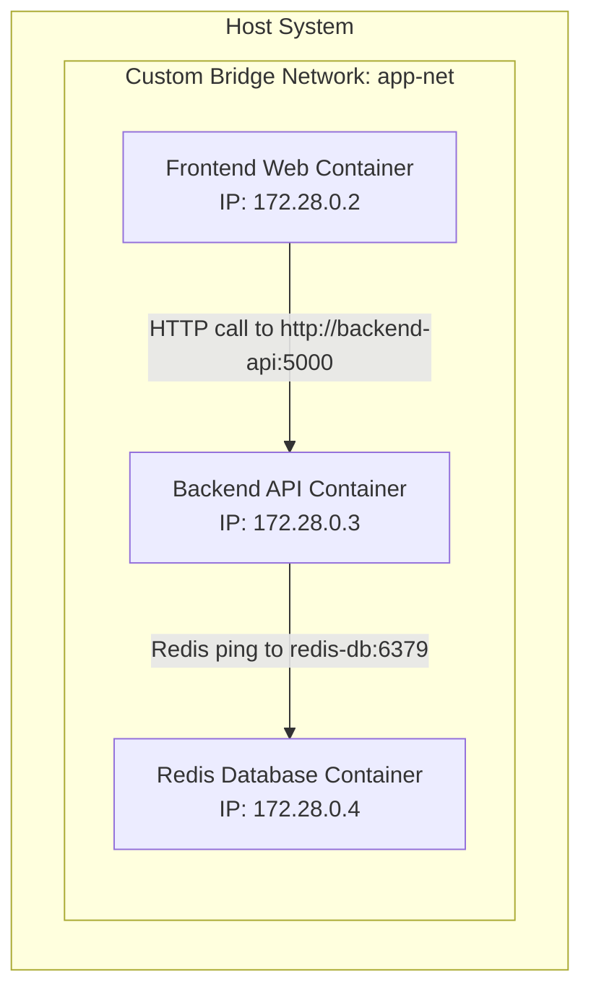

# Module 07 — Docker Networking & Inter-Container Communication

> **🏠 [← Back to Main Course](../README.md)** | **[← Module 06](./06-volumes-storage.md)** | **Next: [Module 08 — Docker Compose →](./08-docker-compose.md)**

---

## 📋 Table of Contents
- [7.1 Fundamentals of Container Networking](#71-fundamentals-of-container-networking)
- [7.2 The 5 Built-in Network Drivers](#72-the-5-built-in-network-drivers)
- [7.3 Deep Dive: Custom Bridge Networks & Embedded DNS](#73-deep-dive-custom-bridge-networks--embedded-dns)
- [7.4 Network Management Commands](#74-network-management-commands)
- [7.5 Hands-on Lab: Connecting Web App to Redis via DNS](#75-hands-on-lab-connecting-web-app-to-redis-via-dns)

---

## 7.1 Fundamentals of Container Networking

Docker networking isolates container traffic while providing seamless communication between authorized containers on the same host or across multiple hosts.



> 🔑 **Key Rule:** Containers on the **same custom network** can communicate with each other using their **container names** as hostnames! Docker's built-in DNS server resolves `http://backend-api` automatically.

---

## 7.2 The 5 Built-in Network Drivers

| Driver | Description | Best Use Case |
| :--- | :--- | :--- |
| **`bridge`** | Default virtual network switch on a single host. | Standard standalone containers needing private isolation. |
| **`host`** | Shares host network directly (no port mapping needed). | High-performance apps (e.g. streaming, webRTC, network tools). |
| **`none`** | Disables network interface (loopback `127.0.0.1` only). | Secure air-gapped batch processing / offline calculation. |
| **`macvlan`** | Assigns a physical MAC address to container on host's subnet. | Legacy apps needing direct access to physical network hardware. |
| **`overlay`** | Connects multiple Docker daemons across cluster nodes. | Docker Swarm & multi-node production deployment. |

---

## 7.3 Deep Dive: Custom Bridge Networks & Embedded DNS

### Default Bridge (`bridge`) vs Custom User-Defined Bridge:

| Feature | Default `bridge` Network | Custom User-Defined Bridge |
| :--- | :--- | :--- |
| **Automatic DNS Resolution** | ❌ No (Must use IP addresses or legacy `--link`) | ✅ **Yes!** (Containers ping each other by name) |
| **Isolation** | ❌ All default containers attach here by default | ✅ **Secure** (Only attached containers can communicate) |
| **Hot Connect/Disconnect** | ❌ Cannot attach/detach while container runs | ✅ Supported live on running containers |

---

## 7.4 Network Management Commands

```bash
# 1. Create a custom isolated bridge network
docker network create my-app-net

# 2. Create network with explicit subnet IP range
docker network create --subnet=172.25.0.0/16 custom-net

# 3. List all networks on host
docker network ls

# 4. Inspect network details, subnets, and connected containers
docker network inspect my-app-net

# 5. Connect an already running container to a network
docker network connect my-app-net my-web-container

# 6. Disconnect container from network
docker network disconnect my-app-net my-web-container

# 7. Remove a network
docker network rm my-app-net

# 8. Delete all unused networks
docker network prune -f
```

---

## 7.5 Hands-on Lab: Connecting Web App to Redis via DNS

Let's test multi-container communication without hardcoding IP addresses!

```bash
# Step 1: Create a dedicated custom bridge network
docker network create internal-net

# Step 2: Launch Redis container attached to internal-net named 'cache-db'
docker run -d --name cache-db --network internal-net redis:alpine

# Step 3: Launch Alpine Linux container on same network and test DNS ping
docker run --rm --network internal-net alpine ping -c 3 cache-db
# Output: PING cache-db (172.20.0.2): 56 data bytes -> Success!

# Step 4: Test querying Redis directly using container name from another container
docker run --rm --network internal-net redis:alpine redis-cli -h cache-db ping
# Output: PONG (Successful connection via DNS name!)
```

---

> **👉 Next Step:** Simplify multi-container setups using Docker Compose YAML files in **[Module 08 — Docker Compose](./08-docker-compose.md)**.
