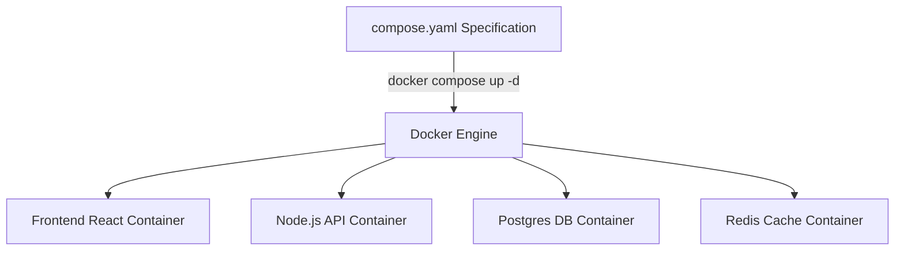

# Module 08 — Multi-Container Orchestration with Docker Compose

> **🏠 [← Back to Main Course](../README.md)** | **[← Module 07](./07-docker-networking.md)** | **Next: [Module 09 — Optimization & Security →](./09-optimization-security.md)**

---

## 📋 Table of Contents
- [8.1 Why Docker Compose?](#81-why-docker-compose)
- [8.2 `compose.yaml` File Structure](#82-composeyaml-file-structure)
- [8.3 Full Real-World Example: Web API + Postgres + Redis](#83-full-real-world-example-web-api--postgres--redis)
- [8.4 Docker Compose CLI Commands](#84-docker-compose-cli-commands)
- [8.5 Environment Variables & `.env` File Integration](#85-environment-variables--env-file-integration)
- [8.6 Service Scaling](#86-service-scaling)

---

## 8.1 Why Docker Compose?

In real-world applications, your software rarely runs in a single container. You usually need a Web API, a Database, an In-Memory Cache, a Background Task Worker, and a Reverse Proxy.

Instead of running 5 long, tedious `docker run` commands in terminal every time, **Docker Compose** lets you define your entire multi-container application stack in a single plain text YAML file (`compose.yaml`).



---

## 8.2 `compose.yaml` File Structure

```yaml
services:
  # Service 1: Web Application
  web:
    build: .                        # Build image from local Dockerfile
    ports:
      - "3000:3000"                 # Host:Container port mapping
    environment:
      - NODE_ENV=production
      - DB_HOST=postgres-db
    depends_on:
      - postgres-db                 # Start DB before starting web app
    networks:
      - app-network

  # Service 2: Database
  postgres-db:
    image: postgres:15-alpine       # Pull prebuilt image from Docker Hub
    environment:
      POSTGRES_PASSWORD: secretpassword
    volumes:
      - db_data:/var/lib/postgresql/data # Persist database data
    networks:
      - app-network

# Top-level Named Volume Definition
volumes:
  db_data:

# Top-level Custom Network Definition
networks:
  app-network:
    driver: bridge
```

---

## 8.3 Full Real-World Example: Web API + Postgres + Redis

Here is a complete, production-ready `compose.yaml` stack with healthchecks and restart policies:

```yaml
name: ecommerce-stack

services:
  api:
    build:
      context: .
      dockerfile: Dockerfile
    container_name: api_server
    restart: always
    ports:
      - "5000:5000"
    environment:
      - PORT=5000
      - DB_URL=postgres://user:pass@db:5432/shop
      - REDIS_URL=redis://cache:6379
    depends_on:
      db:
        condition: service_healthy
      cache:
        condition: service_started
    networks:
      - backend-net

  db:
    image: postgres:15-alpine
    container_name: postgres_db
    restart: always
    environment:
      POSTGRES_USER: user
      POSTGRES_PASSWORD: pass
      POSTGRES_DB: shop
    volumes:
      - postgres_data:/var/lib/postgresql/data
    healthcheck:
      test: ["CMD-SHELL", "pg_isready -U user -d shop"]
      interval: 5s
      timeout: 5s
      retries: 5
    networks:
      - backend-net

  cache:
    image: redis:7-alpine
    container_name: redis_cache
    restart: unless-stopped
    ports:
      - "6379:6379"
    volumes:
      - redis_data:/data
    networks:
      - backend-net

volumes:
  postgres_data:
  redis_data:

networks:
  backend-net:
    driver: bridge
```

---

## 8.4 Docker Compose CLI Commands

> ⚠️ **Note:** Always use `docker compose` (with space, Docker V2 CLI) instead of deprecated `docker-compose` (with hyphen).

```bash
# 1. Start all services in background (detached mode)
docker compose up -d

# 2. Rebuild images and restart services
docker compose up -d --build

# 3. View status of running compose services
docker compose ps

# 4. View aggregated real-time logs from ALL services
docker compose logs -f

# 5. View logs for a SPECIFIC service only
docker compose logs -f api

# 6. Execute a command inside a running compose service
docker compose exec db psql -U user -d shop

# 7. Stop and remove containers, networks
docker compose down

# 8. Stop, remove containers AND delete persistent volumes! (CAUTION)
docker compose down -v
```

---

## 8.5 Environment Variables & `.env` File Integration

Keep secrets out of your `compose.yaml` by storing them in a local `.env` file!

### `.env` file:
```ini
DB_USER=production_admin
DB_PASS=SuperSecretPassword123!
APP_PORT=8080
```

### Reference in `compose.yaml`:
```yaml
services:
  api:
    image: myapp:v1
    ports:
      - "${APP_PORT}:8080"
    environment:
      - POSTGRES_USER=${DB_USER}
      - POSTGRES_PASSWORD=${DB_PASS}
```
Docker Compose automatically loads `.env` files in the same directory.

---

## 8.6 Service Scaling

Docker Compose makes horizontal scaling of stateless containers effortless:

```bash
# Scale the 'api' service to 3 running container instances
docker compose up -d --scale api=3
```

---

> **👉 Next Step:** Learn production image size optimization and security hardening in **[Module 09 — Optimization & Security](./09-optimization-security.md)**.
