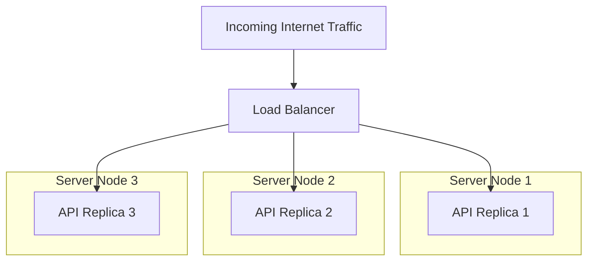
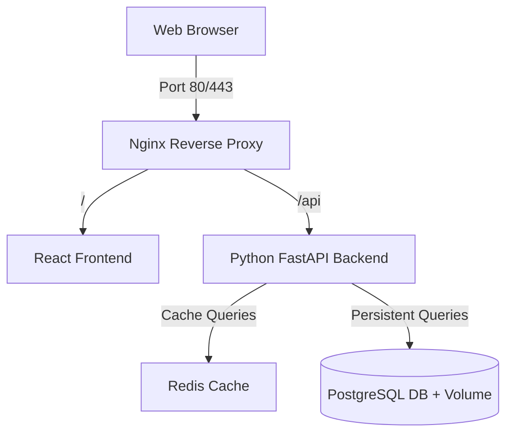

# Module 10 — Orchestration, CI/CD Automation & Production Capstone

> **🏠 [← Back to Main Course](../README.md)** | **[← Module 09](./09-optimization-security.md)**

---

## 📋 Table of Contents
- [10.1 Beyond Single Host: Container Orchestration](#101-beyond-single-host-container-orchestration)
- [10.2 Docker Swarm vs Kubernetes (K8s)](#102-docker-swarm-vs-kubernetes-k8s)
- [10.3 Automated CI/CD Pipeline with GitHub Actions](#103-automated-cicd-pipeline-with-github-actions)
- [10.4 Capstone Project: End-to-End Production Microservices Stack](#104-capstone-project-end-to-end-production-microservices-stack)
- [10.5 Course Graduation & Next Steps](#105-course-graduation--next-steps)

---

## 10.1 Beyond Single Host: Container Orchestration

Running containers on a single computer using Docker Compose is great for local development. However, production systems require running hundreds of containers across a cluster of dozens of cloud servers.

### What Orchestration Solves:
1. **High Availability & Self-Healing:** If Server A crashes, automatically restart its containers on Server B.
2. **Auto-Scaling:** Automatically launch more container instances when traffic spikes.
3. **Zero-Downtime Rolling Updates:** Update containers to v2 without taking down the website.
4. **Load Balancing:** Distribute incoming HTTP traffic evenly across container replicas.



---

## 10.2 Docker Swarm vs Kubernetes (K8s)

| Feature | Docker Swarm | Kubernetes (K8s) |
| :--- | :--- | :--- |
| **Complexity** | Extremely simple (Built right into Docker CLI) | Steeper learning curve |
| **Setup Time** | 5 minutes (`docker swarm init`) | Hours/Days (or managed cloud service like AWS EKS / GCP GKE) |
| **Ecosystem** | Smaller community | Industry standard for enterprise cloud-native apps |
| **Scaling** | Good for small-to-medium apps | Unlimited web-scale cluster orchestration |

---

## 10.3 Automated CI/CD Pipeline with GitHub Actions

Automate building, testing, scanning, and pushing your Docker images whenever code is pushed to your GitHub repository.

### `.github/workflows/docker-ci.yml`:

```yaml
name: Docker Build & Push CI/CD

on:
  push:
    branches: [ "main" ]
    tags: [ 'v*.*.*' ]

jobs:
  build-and-push:
    runs-on: ubuntu-latest
    steps:
      # 1. Checkout source code
      - name: Checkout Code
        uses: actions/checkout@v3

      # 2. Set up QEMU for multi-arch builds (amd64, arm64)
      - name: Set up QEMU
        uses: actions/docker-build-qemu-action@v2

      # 3. Set up Docker Buildx
      - name: Set up Docker Buildx
        uses: actions/setup-buildx-action@v2

      # 4. Log in to Docker Hub using GitHub Secrets
      - name: Log in to Docker Hub
        uses: actions/docker-login-action@v2
        with:
          username: ${{ secrets.DOCKERHUB_USERNAME }}
          password: ${{ secrets.DOCKERHUB_TOKEN }}

      # 5. Extract metadata (tags, labels)
      - name: Extract Docker metadata
        id: meta
        uses: actions/docker-metadata-action@v4
        with:
          images: ${{ secrets.DOCKERHUB_USERNAME }}/my-production-app

      # 6. Build & Push Image with Caching
      - name: Build and Push Docker Image
        uses: actions/docker-build-push-action@v4
        with:
          context: .
          platforms: linux/amd64,linux/arm64
          push: true
          tags: ${{ steps.meta.outputs.tags }}
          labels: ${{ steps.meta.outputs.labels }}
          cache-from: type=gha
          cache-to: type=gha,mode=max
```

---

## 10.4 Capstone Project: End-to-End Production Microservices Stack

In this Capstone project, you will deploy a complete 5-tier microservices architecture:

1. **Nginx Reverse Proxy:** SSL termination & static asset routing.
2. **React Frontend:** User interface built via multi-stage build.
3. **Python FastAPI Backend:** REST API service with non-root security.
4. **Redis Cache:** Session and temporary query caching.
5. **PostgreSQL Database:** Persistent transactional database with named volumes.



### Production `compose.yaml` Capstone Blueprint:

```yaml
name: production-capstone

services:
  reverse-proxy:
    image: nginx:alpine
    container_name: capstone_nginx
    restart: always
    ports:
      - "80:80"
    volumes:
      - ./nginx.conf:/etc/nginx/nginx.conf:ro
    depends_on:
      - frontend
      - backend-api
    networks:
      - web-net

  frontend:
    build:
      context: ./frontend
      dockerfile: Dockerfile
    container_name: capstone_frontend
    restart: always
    networks:
      - web-net

  backend-api:
    build:
      context: ./backend
      dockerfile: Dockerfile
    container_name: capstone_api
    restart: always
    environment:
      - DB_HOST=database
      - REDIS_HOST=cache-redis
    depends_on:
      database:
        condition: service_healthy
    networks:
      - web-net
      - internal-db-net

  cache-redis:
    image: redis:7-alpine
    container_name: capstone_redis
    restart: always
    networks:
      - internal-db-net

  database:
    image: postgres:15-alpine
    container_name: capstone_postgres
    restart: always
    environment:
      POSTGRES_USER: capstone_user
      POSTGRES_PASSWORD: SecurePassword99!
      POSTGRES_DB: capstone_db
    volumes:
      - capstone_pg_data:/var/lib/postgresql/data
    healthcheck:
      test: ["CMD-SHELL", "pg_isready -U capstone_user -d capstone_db"]
      interval: 5s
      timeout: 5s
      retries: 5
    networks:
      - internal-db-net

volumes:
  capstone_pg_data:

networks:
  web-net:
    driver: bridge
  internal-db-net:
    driver: bridge
    internal: true # Air-gapped internal database network!
```

---

## 10.5 Course Graduation & Next Steps

🎉 **Congratulations!** You have completed the **Docker & Containerization Master Course**.

### What You Have Mastered:
- ✅ **Core Terminologies:** Container, Image, Daemon, Volume, Network, Layering, OCI, Namespaces, Cgroups.
- ✅ **Container CLI Operations:** Lifecycle management, port mapping, logs, exec, stats, and inspection.
- ✅ **Dockerfile Engineering:** Layer optimization, `.dockerignore`, multi-stage builds, non-root security.
- ✅ **Data Persistence & Storage:** Volumes, Bind Mounts, `tmpfs`, database backup/restore workflows.
- ✅ **Networking:** Bridge networks, DNS resolution, port forwarding, isolated subnets.
- ✅ **Multi-Container Apps:** Docker Compose stack specification and multi-service management.
- ✅ **Production & Automation:** Security hardening, resource limits, CI/CD automation with GitHub Actions.

### Recommended Next Steps:
1. **Kubernetes (K8s):** Learn Pods, Deployments, Services, and Helm charts for enterprise cloud orchestration.
2. **Cloud Container Deployment:** Deploy your containers to AWS ECS / Fargate, Google Cloud Run, or Azure Container Apps.

---

> **🏠 [Back to Main Course Landing Page](../README.md)**
